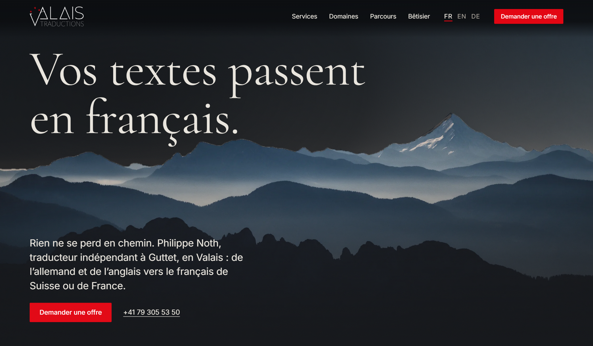
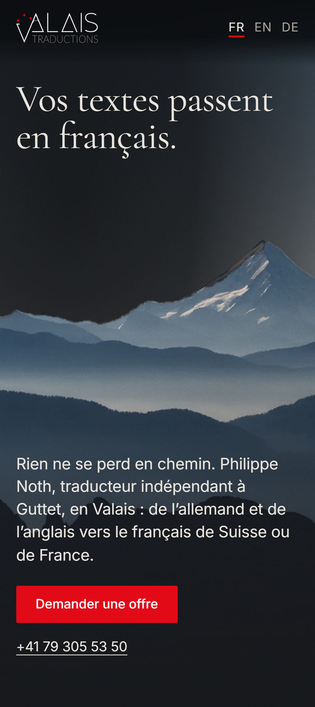
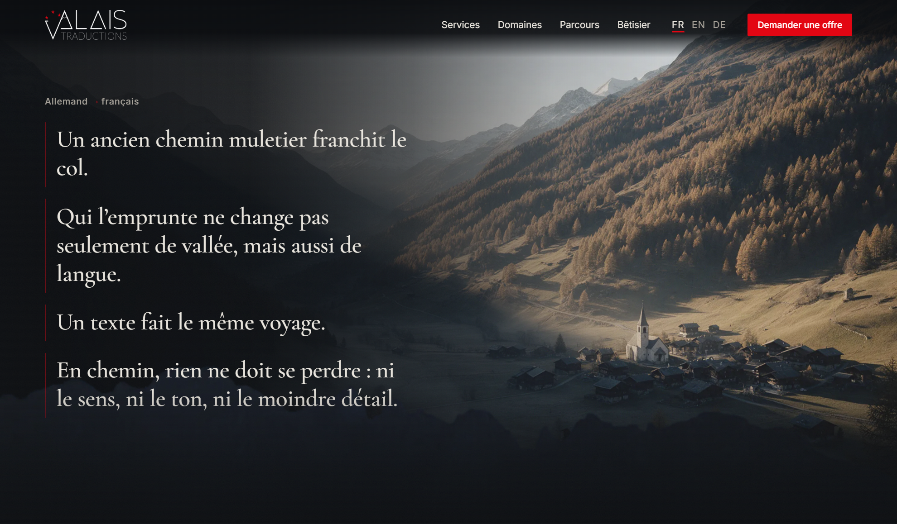

# valaistraductions.ch

Site for [Valais Traductions](https://www.valaistraductions.ch) — Philippe Noth, freelance translator (German and English into French) in Guttet, Valais, Switzerland.

Static, trilingual (FR / EN / DE), no framework, no build step. HTML and CSS, a small scroll engine, a page script, and one PHP script for the contact form. It replaces the former WordPress site.

## Screenshots

<p align="center">
  
</p>

<p align="center">
  
  &nbsp;&nbsp;
  
</p>

## Structure

```
/
├── index.html          # Fallback redirect (browser language → fr/, de/ or en/)
├── .htaccess           # Apache: language redirect, old WordPress addresses, 404
├── 404.html
├── contact.php         # Contact form handler (sends an e-mail)
├── assets/             # Favicons (kept from the old site)
├── css/
│   ├── scrollcraft.css # Scroll engine floor (third-party, do not edit)
│   └── style.css       # The site's own styles, design tokens at the top
├── js/
│   ├── scrollcraft.js  # Scroll engine (third-party, do not edit)
│   └── script.js       # Home page behaviour: translation on scroll, Swiss/French switch, form
├── images/             # Logo, hero planes, photographs, portrait, book covers, bêtisier screenshots
├── fr/  en/  de/       # One folder per language, mirrored content
│   ├── index.html      # Home page
│   └── betisier.html   # Bêtisier / Bloopers / Stilblüten
├── docs/
│   └── screenshots/    # Screenshots for this README (not deployed)
└── scrollcraft/        # Design workspace: brief, prototype, plane-cutting script (not deployed)
```

Text changes must be made in all three language folders.

## Design

Dark, alpine, quiet: charcoal ground, bone and dust text, Cormorant Garamond for display and Inter for running text, in the family of noth.ch. The only accent is the red of the logo's three stars (`#E30613`).

The home page opens on one pinned scene, the crossing:

1. The cold side of a pass at blue hour. One photograph cut into four planes (`images/dusk-plate.webp`, `dusk-r3`, `dusk-r2`, `dusk-r1`) that slide apart as the page approaches the nearest ridge.
2. The ridge fills the frame, then drops away on the far side: a Valais village at first light (`images/dawn.webp`).
3. Meanwhile a paragraph turns from German (English on the English page) into French, one segment at a time, driven by scroll.

After that the page is plain: services, a sideways rail of subjects, a Switzerland / France switch whose choice is carried into the contact form, the portrait, the form, and the valley in daylight.

With `prefers-reduced-motion`, nothing travels: the two sides cross-fade and the paragraph shows source and translation together. Without JavaScript all text is visible in place.

The mountain, village and subject photographs were generated (kie.ai); the portrait is a real photograph. The brief and the rationale are in `scrollcraft/builds/valais-traductions/BRIEF.md`.

## Running locally

```powershell
php -S localhost:8124
```

Then open <http://localhost:8124>. The contact form needs a mail server, so locally it shows its error message.

To retake the screenshots above while that server runs (Node and `playwright-core` are only needed for this):

```powershell
cd scrollcraft/builds/valais-traductions
npm install
node lab/doc_shots.mjs
```

## Deploying

Copy the contents of this folder to the web root of an Apache host with PHP, without `scrollcraft/`, `docs/`, `.env` and `.git`. Before going live, check the two addresses at the top of `contact.php` (`MAIL_TO`, `MAIL_FROM`).

`.htaccess` redirects the old WordPress addresses (`/about/`, `/fr/a-propos/`, the blog posts, …) to their new place, so existing links and search results keep working.
